# ocphotos

A Memories-style photo experience for [OpenCloud](https://opencloud.eu): a date timeline,
"on this day", places, albums, tags, folders, a map and duplicates, with OpenCloud as the
source of truth for the files.

It is a **native OpenCloud web extension** (Vue 3 + extension-sdk, session-based, no iframe)
plus a **Go photo service** (part of [ocapps](https://github.com/gnacho/ocapps)) that keeps
the metadata index (EXIF, GPS, tags, albums, hashes) and generates thumbnails, including HEIC.

## Screenshots

| Timeline (justified, month/day headers, Rewind) | On this day |
|---|---|
| 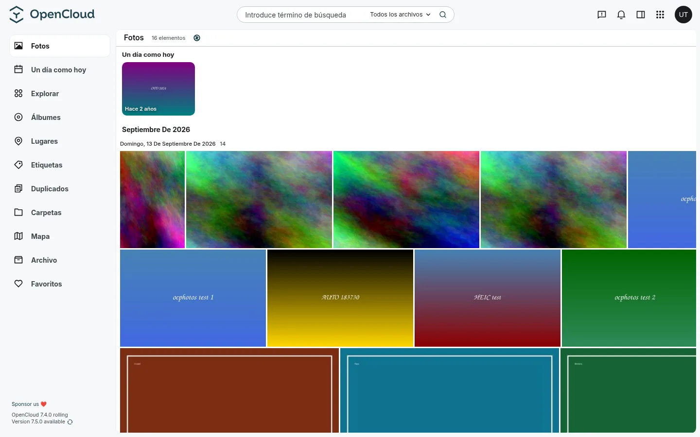 | 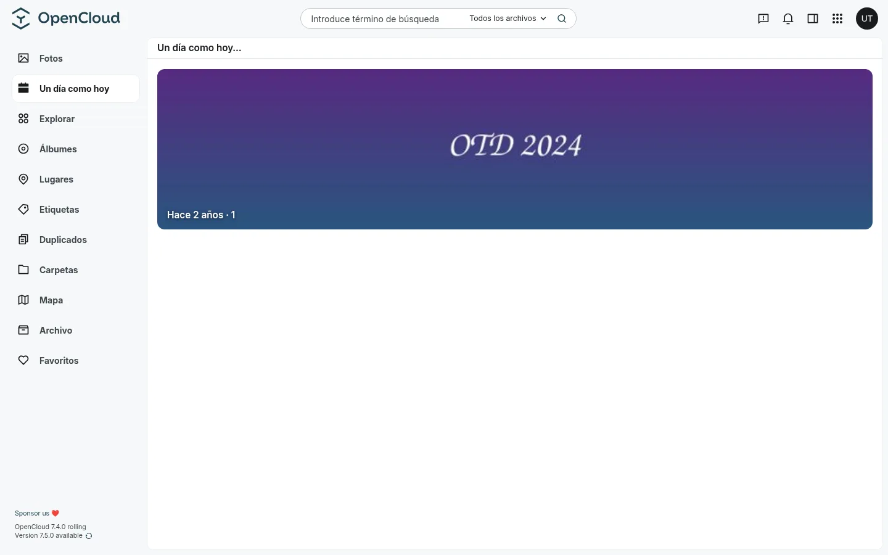 |

| Explore (search hub) | Albums |
|---|---|
| 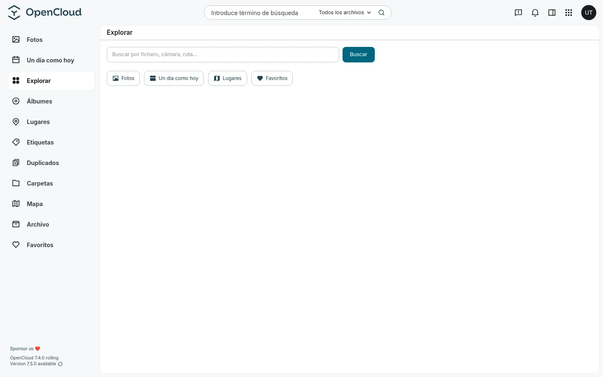 | 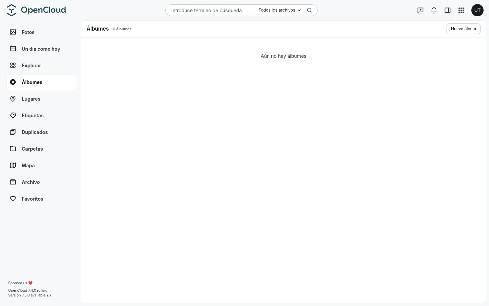 |

| Places (reverse geocoded) | Tags |
|---|---|
| 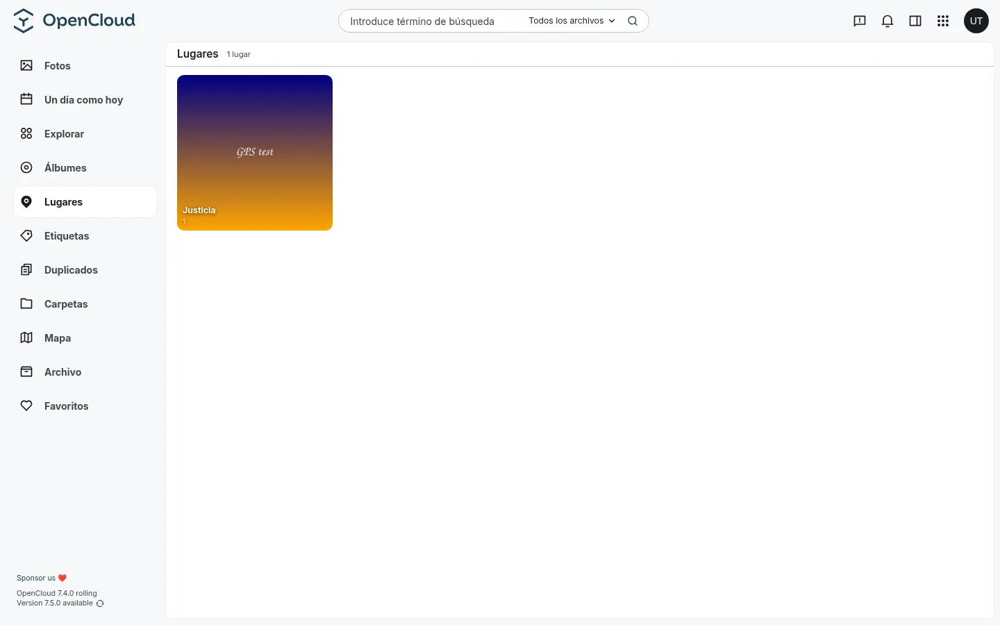 | 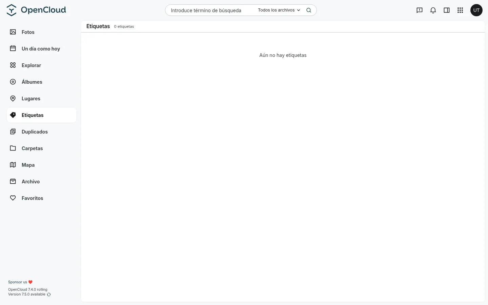 |

| Folders (OpenCloud tree) | Map (thumbnail markers) |
|---|---|
| 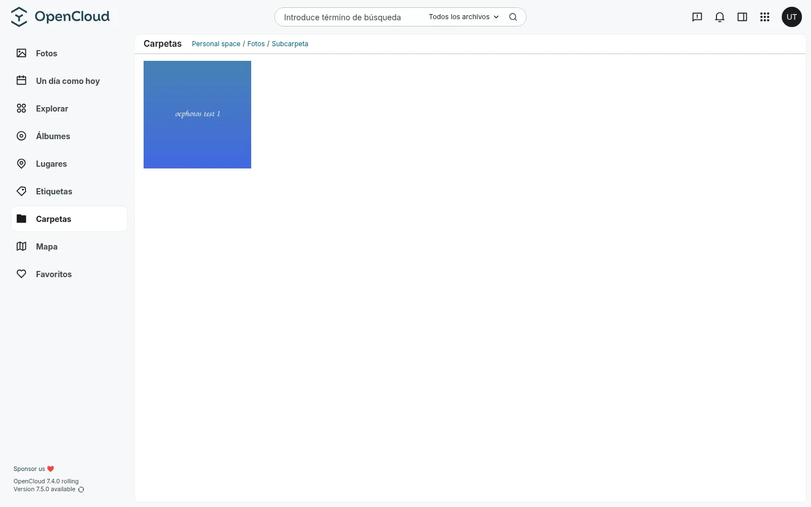 | 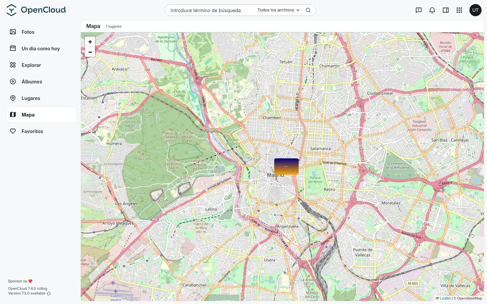 |

| Duplicates (perceptual hash) | Archive |
|---|---|
| 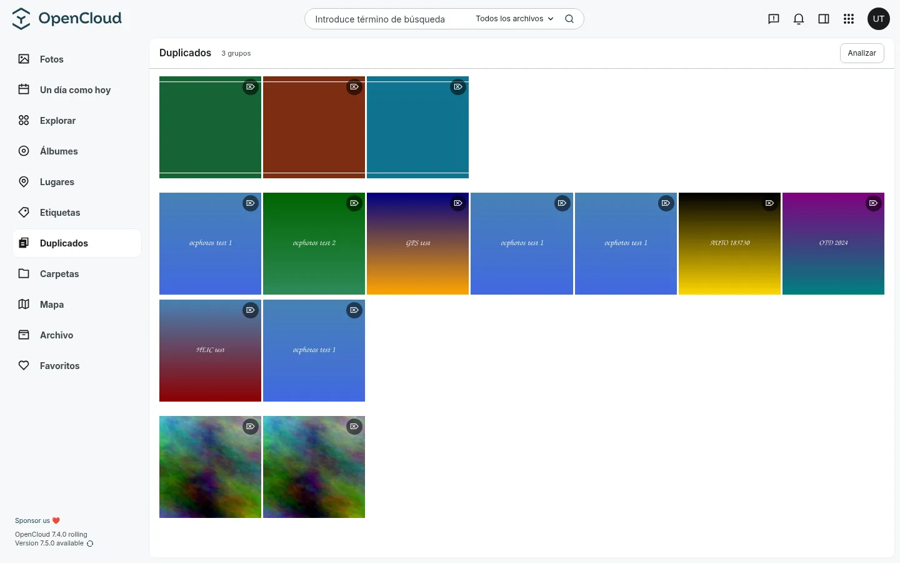 | 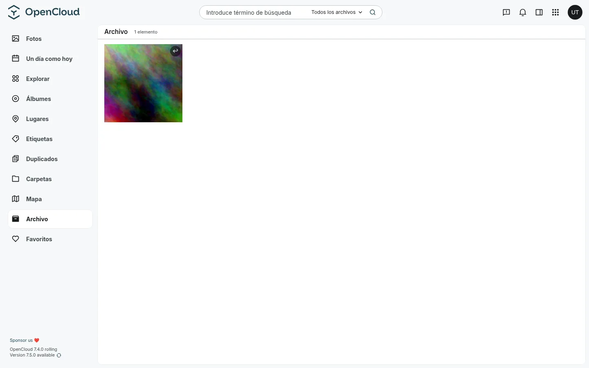 |

| Favorites | Viewer |
|---|---|
| 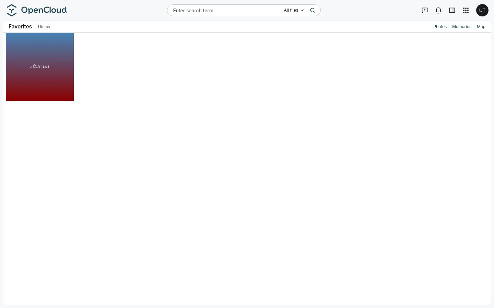 | 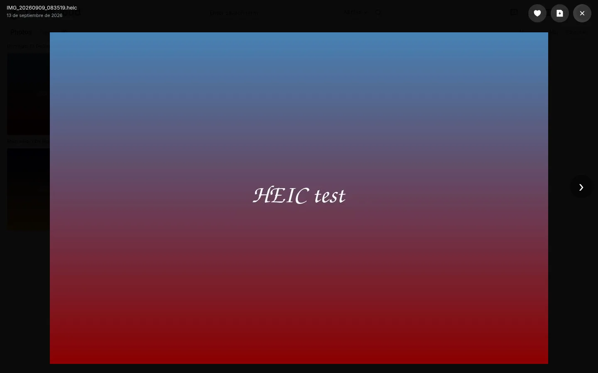 |

## Features

- **Timeline** grouped by month and day, with EXIF capture dates, a justified layout
  (fixed-height rows, widths by aspect ratio), infinite scroll and **Rewind** (year/month
  scrubber to jump to any date).
- **On this day**: highlights strip with "N years ago" cards; falls back to the same month of
  previous years, then to the oldest photos, so it is never empty.
- **Explore**: hub with metadata search (file, camera, path) and quick links.
- **Albums**: create, rename, delete, add/remove photos (from the viewer or the grid).
- **Places**: GPS photos clustered by area (~1 km) with **reverse geocoding** (Nominatim,
  cached in SQLite).
- **Tags**: manual tags, added from the viewer; tag list with counts.
- **Folders**: browse the real OpenCloud folder tree (derived from the index) with breadcrumbs.
- **Map**: photo **thumbnail markers** with count badges, grouped by place; click opens the photos.
- **Duplicates**: perceptual hashes (dHash) to find near-identical photos.
- **Archive**: hide photos from the timeline and keep them in their own view.
- **Videos**: posters generated with ffmpeg (the timeline shows a real frame) and playback
  via a **signed same-origin URL with HTTP Range** streaming.
- **Favorites**, **auto-sync** (new photos show up on their own) and **HEIC/HEIF** support
  (pure-Go decoder in the service).
- **Metadata that outlives the index**: tags and favorites are written as XMP sidecars
  (`<photo>.xmp`) next to the file, and the scanner reads sidecars left by other tools
  (Lightroom, darktable) back into the library, so a reindex or a moved file does not lose them.
- **Native navigation**: the sections live in OpenCloud's left sidebar (`navItems`), and the
  UI is translated to Spanish (`l10n/translations.json`, follows the host language).
- **Multi-user**: each OpenCloud account has its own photo library. The first time a user
  opens the app, their photos are indexed on demand. Background scanning is supported via
  app-tokens (see [ocapps](https://github.com/gnacho/ocapps) docs).

## Architecture

```
OpenCloud (source of truth: files in each user's personal space)
    |  WebDAV + Graph + OIDC session (per user)
    v
ocapps backend (Go, SQLite)  --  index per user (EXIF, GPS, tags, albums, pHash), thumbnails, REST API
    ^  /ocphotos-api/ (same origin, reverse proxy)
    |
ocphotos extension (Vue 3)  --  timeline, on this day, explore, albums, places, tags,
                                folders, map, duplicates, archive, favorites, viewer
```

The extension never stores credentials: it calls the service with the host session bearer,
and the service validates it against OpenCloud's Graph `/me`. Each user gets their own
isolated index (scoped by `oc_id`).

Metadata is not trapped in that index: tags and favorites are mirrored to `.xmp` sidecars next
to each file, and the scanner projects sidecars written by other editors back into the library.

## Install

### The easy way (`ocapps-ext`)

The app ships as a release asset and can be installed and updated from the
server with [`ocapps-ext`](https://github.com/gnacho/ocapps/blob/main/deploy/README.md):

```bash
ocapps-ext install ocphotos  # first install: download, apps.yaml entry, restart, verify
ocapps-ext update            # update every app that came from a release
ocapps-ext update --dry-run  # show what would change, touch nothing
ocapps-ext rollback ocphotos # restore the previous directory
```

It picks the newest release whose asset matches the app, replaces the folder
under `/etc/opencloud/web/assets/apps`, restarts OpenCloud once and checks that
the app appears in `/config.json` with a reachable entry point. If that check
fails it restores the previous build on its own. Directories built by hand are
marked `local:<date>` and are never overwritten unless you pass `--force`.

### Manual install

Download the latest release zip from the [releases page](https://github.com/gnacho/ocphotos/releases):

```bash
# Download ocphotos-X.Y.Z.zip and extract to your OpenCloud apps folder
# (commonly /var/lib/opencloud/web/assets/apps or /etc/opencloud/web/assets/apps)
```

Add to `/etc/opencloud/apps.yaml`:

```yaml
ocphotos:
  config: {}
```

Restart OpenCloud. The ocphotos app appears in the app switcher.

### Build from source

```bash
cd ocphotos
pnpm install && pnpm build
```

Copy `dist/` to the OpenCloud apps folder as `ocphotos/`.

### Backend (ocapps)

The backend lives in the [ocapps](https://github.com/gnacho/ocapps) repo.
See its `deploy/README.md` for the full installation guide (systemd,
environment variables, reverse proxy snippets).

Quick reference for the proxy:

```nginx
location /ocphotos-api/ {
    proxy_set_header Host $host;
    proxy_set_header X-Forwarded-Proto $scheme;
    proxy_pass http://127.0.0.1:8096;
}
```

## Mobile app (Android)

Photos has a native Android client: [ocphotos-android](https://github.com/gnacho/ocphotos-android)
(Kotlin + Jetpack Compose, AGPL-3.0). It talks to the same API under `/ocphotos-api`
served by `ocapps`, so it needs the backend and the proxy route above.

- Download the signed APK from the [latest release](https://github.com/gnacho/ocphotos-android/releases/latest).
- Log in with the OpenCloud server URL, your user name and an **app token** (the
  six-word passphrase from OpenCloud, App tokens), not your account password.
- It reads the photo index built by the backend scanner. If the library looks empty
  while the web app shows photos, the scanner has nothing indexed for that account
  yet: check `OCAPPS_PHOTOS_SCAN_ROOT` and trigger a rescan.

## Development

```bash
# native extension
cd ocphotos
pnpm install
pnpm build        # pnpm build:w to watch
pnpm check:types
pnpm lint
pnpm test:unit
pnpm test:coverage
```

The suite runs on Vitest with happy-dom. `pnpm test:coverage` adds a V8 coverage
report and fails when the totals drop below the thresholds declared in
`ocphotos/vitest.config.ts`: 95 % statements, 88 % branches, 88 % functions and
96 % lines overall, with stricter floors for `src/composables/**` and
`src/components/**`.

```bash
# standalone app
cd app
npm install
npm run dev
npm run lint
npm run test:coverage
```

The app suite runs on jsdom and covers the app's own code: the API client, the
store, the day grouping and every component under `src/components/`. Its
thresholds live in `app/vitest.config.ts`. The shadcn components under
`src/components/ui/`, the demo data and the types stay out of the measure.
`app/README.md` covers the three connection modes and how to serve the build,
and `deploy/README.md` section 4 has the proxy it needs.

### Continuous integration

`.github/workflows/ci.yml` runs on every pull request and on pushes to `main`,
always with Node 24. It has three jobs:

- `Repo (no backend, no Docker)` fails if a Go file, a `go.mod`, a Dockerfile, a
  compose file or a `.dockerignore` appears here. The service lives in
  [ocapps](https://github.com/gnacho/ocapps), and this check keeps a second copy
  from growing back.
- `Extension (overrides, types, lint, tests, coverage, build)` installs with a frozen
  lockfile, then runs types, lint, tests with coverage and the build.
- `Standalone app (lint, tests, coverage, build)` runs `npm ci`, then lint, tests
  with coverage and the build.

A red check means one of those steps failed. Coverage is part of the build, so
adding code without tests can turn the CI red.

## License

GNU Affero General Public License v3.0 (AGPL-3.0-only). See [LICENSE](LICENSE).
